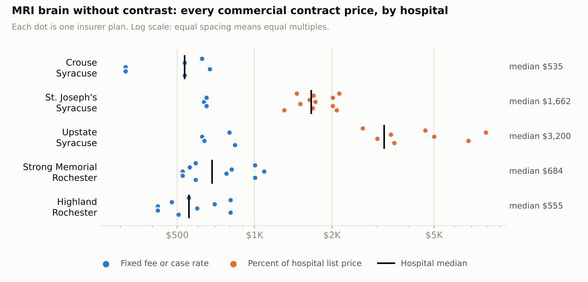
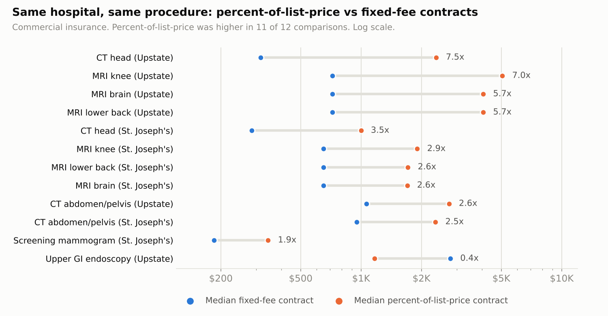

# Hospital Price Transparency: Syracuse and Rochester, NY

**How much does the same procedure cost at different hospitals, and why?** I pulled the 2026 price files that hospitals are required by federal law to publish, cleaned about 4.5 GB of messy data from six hospitals into one SQL database, and compared negotiated insurer prices for 10 common procedures.

**[Open the interactive dashboard](https://michaelmiller5.github.io/hospital-price-transparency/dashboard/)** · [Recommendations memo](docs/recommendations_memo.md) · [Key findings](docs/key_findings.md) · [Every data judgment call](docs/judgment_calls.md)



## Key findings

1. **Which hospital is cheapest depends on the insurer contract, not just the hospital.** For an MRI brain, commercial contract prices ranged from $315 to $7,957 across the five hospitals compared, about 25 times. For the five CT and MRI services, how the contract is set explains about 75% of the price variation; which hospital explains about 50%.
2. **Contracts that pay a percentage of the hospital's list price produce the extreme prices.** At Upstate and St. Joseph's, they were higher than the same hospital's fixed-fee contracts in 11 of 12 comparisons, by 1.9 to 7.5 times.
3. **On fixed-fee contracts, hospital differences are modest but real.** The most expensive hospital was 1.3 to 1.5 times the cheapest for 8 of 10 services (1.5 to 1.9 times if only one of the two price lists that Strong and Highland publish is used). For the same insurer in the same city, the gap is $4,500 to $10,000 per outpatient knee replacement.
4. **One hospital's file could not support a fair comparison.** Rochester General's 2026 file lists insurer dollar prices for these outpatient services from one insurer at most, so it is reported as a transparency gap instead.



The [recommendations memo](docs/recommendations_memo.md) turns these into five actions for an employer or health plan, such as auditing percent-of-charges exposure at specific hospitals and steering scheduled imaging within each city.

## What I did

| Step | Work | Where |
|---|---|---|
| Sourcing | Found each hospital's official file through its CMS-required `cms-hpt.txt` index, and checked every file's header (hospital name, address, license) before use. This caught a same-named hospital in Minnesota and a file that had moved to a new 2026 location. | [judgment calls S1 to S4](docs/judgment_calls.md#source-files) |
| Extraction | Streamed files of up to 3.3 GB (one zipped) and kept only the rows for the 10 study procedures. | [`scripts/extract_procedures.py`](scripts/extract_procedures.py) |
| Cleaning | Combined two layouts (wide and tall) into one table of 18,245 price rows. Separated hospital fees from physician fees, removed billing-modifier variants, behavioral-health carve-out contracts and duplicates, and standardized hundreds of insurer and plan spellings. Every excluded row keeps a written reason. | [`scripts/clean_rates.py`](scripts/clean_rates.py) |
| Database | DuckDB with base tables and layered SQL views: usable rates, one price per contract, hospital summaries, comparisons and an exclusion audit. | [`sql/`](sql/) |
| Statistics | Variance decomposition on log prices, within-hospital contract-type comparisons, same-insurer comparisons across hospitals, commercial vs Medicare Advantage ratios. | [`scripts/analysis_stats.py`](scripts/analysis_stats.py) |
| Verification | Traced 40 randomly sampled prices (8 per hospital) back to the exact line in each hospital's original file: 40 of 40 matched. Re-ran the whole pipeline after reorganizing the repo and confirmed identical outputs. | [`scripts/verify_against_raw.py`](scripts/verify_against_raw.py) |
| Communication | Interactive dashboard (plain HTML and JavaScript, no libraries), a recommendations memo, and README charts. | [`dashboard/`](dashboard/), [`docs/`](docs/) |

**Tools:** Python (pandas, NumPy, matplotlib), SQL (DuckDB), HTML, CSS, JavaScript, Git.

## Scope

- **Hospitals:** Crouse, St. Joseph's Hospital Health Center and Upstate University Hospital (Syracuse); Strong Memorial and Highland (Rochester). Rochester General (Rochester) is covered as a transparency finding.
- **Procedures:** MRI brain (CPT 70551), MRI knee or leg joint (73721), MRI lower back (72148), CT head (70450), CT abdomen and pelvis (74177), screening mammogram (77067), diagnostic colonoscopy (45378), upper GI endoscopy with biopsy (43239), outpatient knee replacement (27447), and the inpatient hip or knee replacement stay (MS-DRG 470).
- **Prices:** hospital facility fees for the base service, as each hospital published them in its 2026 file.

## Limits

- These are published negotiated rates, not claims. They do not show what was actually paid or what a patient owed.
- Contracts are counted equally. The files do not say how many people each plan covers.
- For percent-of-list-price contracts, the dollar figure is the hospital's own estimate.
- Quality of care is not included.
- Some comparisons rest on few contracts (inpatient joint replacement has 2 to 6 commercial contracts per hospital). Counts are shown next to every number.

## Repository layout

```
dashboard/       interactive dashboard (index.html is built from template.html)
data/filtered/   rows for the 10 procedures, copied unchanged from each hospital file
data/processed/  cleaned table, DuckDB database, analysis tables
docs/            key findings, recommendations memo, data judgment calls
images/          README charts
scripts/         extraction, cleaning, database, statistics, charts, dashboard
sql/             table and view definitions
```

## Reproduce it

```bash
pip install -r requirements.txt

# 1. Optional: re-extract from the raw files (download them into data/raw/ first)
python scripts/extract_procedures.py data/raw/16-0960470_Crouse-Hospital_standardcharges.csv data/filtered/crouse_filtered.csv
#    ...repeat for each hospital file

# 2. Rebuild everything else: cleaning, database, statistics, dashboard
python scripts/run_all.py
python scripts/make_charts.py
```

Raw files (not stored here; several are over GitHub's 100 MB limit), from each hospital's `cms-hpt.txt`:

| Hospital | File last updated | Source |
|---|---|---|
| Crouse Hospital | 2026-05-19 | [CSV](https://www.crouse.org/wp-content/uploads/2026/05/16-0960470_Crouse-Hospital_standardcharges.csv) |
| St. Joseph's Hospital Health Center | 2026-03-31 | [ZIP](https://hpt.trinity-health.org/150532254_st-josephs-hospital-health-center_standardcharges.zip) |
| Upstate University Hospital | 2026-09-05 | [CSV](https://www.upstate.edu/hospital/files/161469571_upstate-university-hospital_standardcharges.csv) |
| Strong Memorial Hospital | 2026-07-01 | [CSV](https://www.urmc.rochester.edu/getmedia/b1fa98a4-bf2c-4b54-883d-edbc50653e7a/161029490-STRONG-MEMORIAL-HOSPITAL-standardcharges.csv) |
| Highland Hospital | 2026-07-01 | [CSV](https://www.urmc.rochester.edu/getmedia/5479e418-958b-4a8a-b3ab-610f5962d661/160743037-HIGHLAND-HOSPITAL-OF-ROCHESTER-standardcharges.csv) |
| Rochester General Hospital | 2026-04-01 | [CSV](https://msc.rochesterregional.org/practitionerPortal/docs/MRF2026/160743134_rochester-general-hospital_standardcharges.csv) |

Hospitals update these files regularly, so a fresh download may not match the numbers here.

## About

Michael Miller · [LinkedIn](https://www.linkedin.com/in/michael-miller99) · [GitHub](https://github.com/michaelmiller5)

Code is under the MIT License. Hospital price data is public information published by each hospital under 45 CFR Part 180.
